# Give a browser access to your host

This guide connects your own browser to the host on your machine, and then
gives someone else's browser access to it, first read-only and then with
typing. Every screenshot comes from a real local run that used synthetic
accounts (`owner@example.com`, `guest@example.com` and
`teammate@example.com`).

There are three separate steps, and only the last one grants anything:

- **Signing in** to the server identifies an account.
- **Connecting a machine** in the hosted app tells your browser which host to
  talk to.
- **Trusting a browser key** on the host is the only step that grants access.
  It happens on the machine itself, in the local host page or with
  `conversations credential add`. Nothing on the server or in an
  account can grant it.

A browser key belongs to one browser profile. A different browser, a new
profile or a private window has a different key, so it needs its own approval.

## Prerequisites

- **A server account.** You have an account on the Conversations server.
- **One server for every command.** On the host machine, set the server
  once in each shell you use, then sign in and start the host:

  ```sh
  export CONVERSATIONS_SERVER=https://conversations.example.com
  conversations login
  conversations host
  ```

  `CONVERSATIONS_SERVER` does the same as the global `--server <url>`
  option. Without either, a command uses the default saved by `login`, and
  `login` only offers to save one when it can prompt in a terminal. Every
  command in this guide must reach the same server.
- **A running host.** `conversations host` runs in the foreground on
  the machine where your agents run. Its management UI listens on loopback
  only (`http://localhost:8089` by default). The host never opens a browser by
  itself.
- **The current executable.** The executable is named `conversations`.
  After an upgrade, restart any host that is already running (see
  [Troubleshooting](#troubleshooting)).
- **A normal browser profile.** Use the browser profile you will keep using. A
  fresh profile is a new identity.

## Part 1: your own browser

### Open the local host page

From a second shell on the host machine, with the same
`CONVERSATIONS_SERVER`:

```sh
conversations open
```

`open` prints the local address and opens your browser with a one-time link.
The page exchanges that link for a cookie and removes it from the address bar.

- Don't copy or share the link.
- If the browser didn't open, run `open` again rather than reusing an old link.


*1. The local host page, opened by `conversations open`.*

Go to **Settings** (gear icon) → **Host access**. On a new host, **People with
access** is empty.

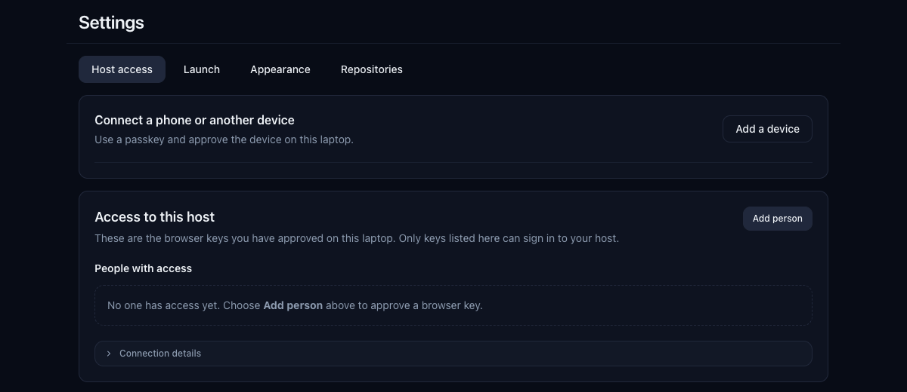

*2. Local Settings → Host access before anyone is approved.*

Expand **Connection details** to see the **Host descriptor**, which starts
with `chd1.`. It is public, and is the same value that
`conversations credential descriptor` prints.

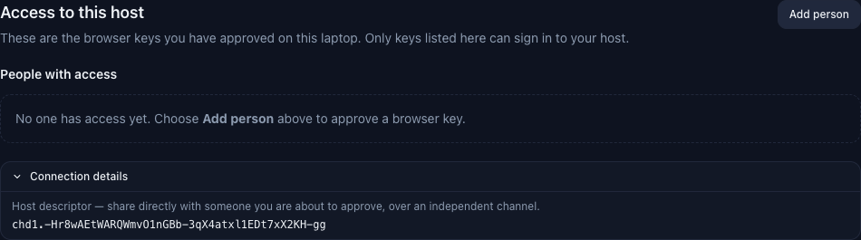

*3. The host descriptor under Connection details.*

### Connect the machine in the hosted app

1. In your normal browser, sign in to the hosted app.
2. Open **Settings** → **Host access**.
3. Under **Set up your machine**, fill in:
   - **Host descriptor**: paste the descriptor;
   - **Machine name**: a name for this machine;
   - **Browser name**: a name for this browser.
4. Choose **Connect machine**.

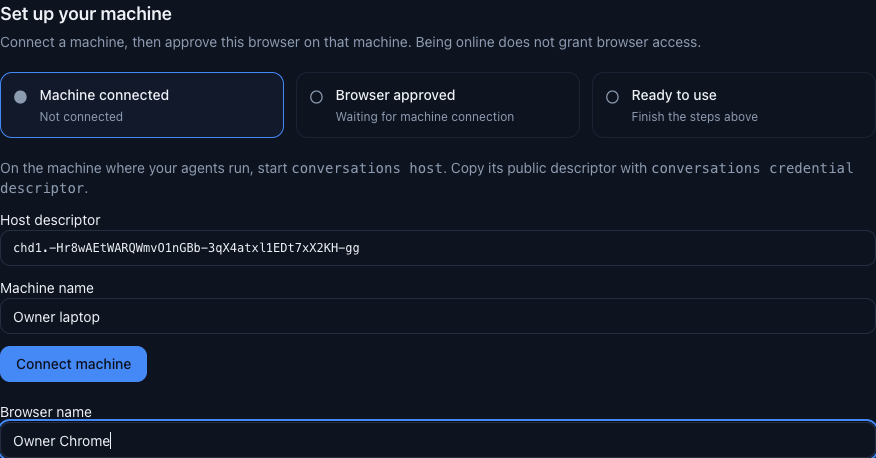

*4. Connecting the machine from the hosted app.*

When the host is running, **Machine connected** turns to *Online*. The
browser is still *Not approved*: being online grants nothing. Choose **Prepare
this browser for approval**.

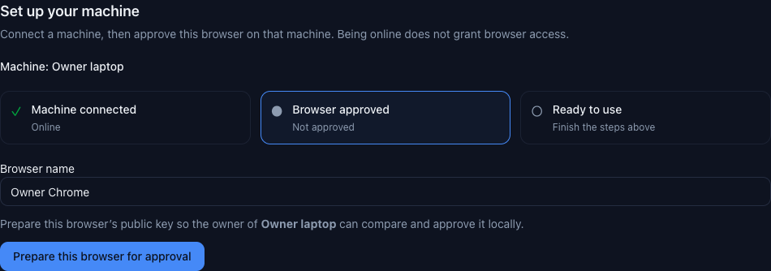

*5. Online but not approved.*

The page publishes this browser's public key and shows its full fingerprint.
The page says so itself: *Publication does not notify this machine or grant
access.* Leave this page open; it detects the approval by itself.

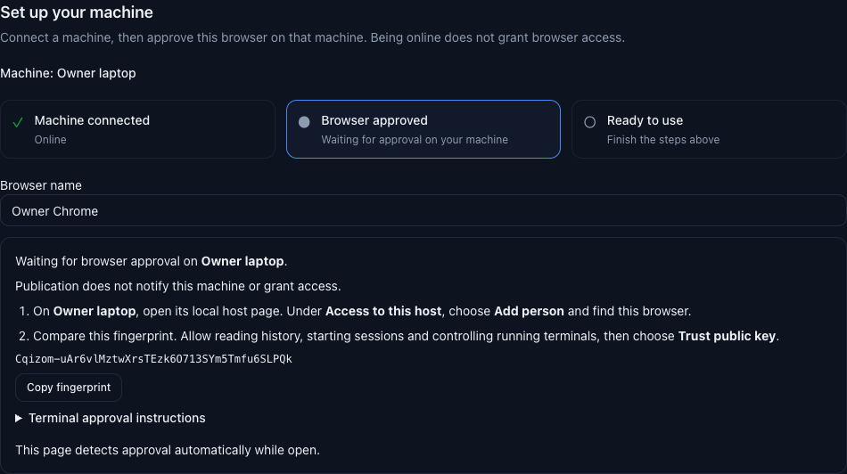

*6. Waiting for approval. The fingerprint shown is synthetic; compare the one
your own browser shows.*

### Approve your browser on the host

In the local host page, under **Access to this host**:

1. Choose **Add person**.
2. Search for your email under **Search published keys**, then select the
   browser you just named.
3. Compare the fingerprint under **Compare this fingerprint independently**,
   character by character, with the one the hosted page shows.
4. Under **Permissions on this host**, tick:
   - **Read session history**;
   - **Start sessions**;
   - **Control running terminals**.

   The hosted setup only reports *Ready* once the browser can read history and
   start sessions.
5. Tick **I independently compared this exact fingerprint with its owner.**
6. Choose **Trust public key**.

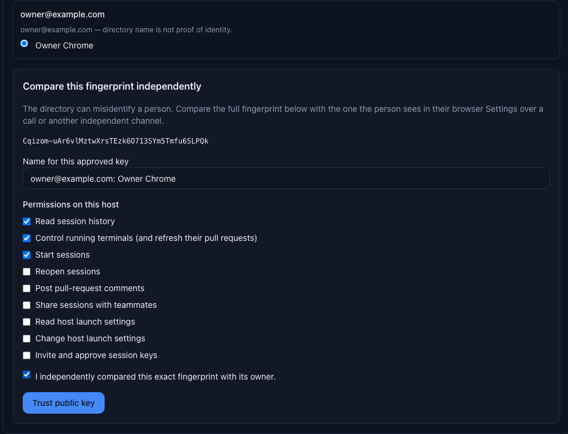

*7. Trusting your own browser key with read, start and control permissions.*

The browser now appears under **People with access**, with its permissions.

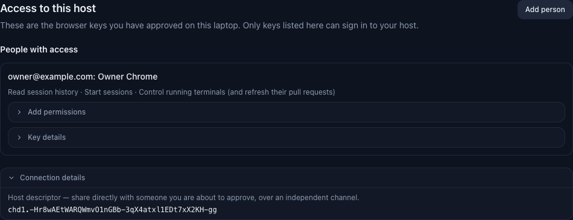

*8. Your browser is approved on this host.*

Choose permissions carefully. You can't widen the core permissions of a key
once it is trusted:
- **Add permissions** later offers only the extra, owner-level permissions;
- to change anything else, revoke the key and approve a new browser key.

### Approve a browser from its fingerprint alone

A browser that is signed in but not connected to any machine can still be
approved. On **Sessions**, choose **Publish my fingerprint**, then approve that
fingerprint on your machine as above. Keep **Sessions** open: the browser asks
each machine your account has connected whether it approved this exact key.
When the machine opens a private connection for the key, the browser connects
to that machine by itself and lists its sessions. You don't need a setup link.

The server only tells the browser which machines your account connected. The
browser connects only after the machine answers with a statement signed by its
own identity key.

### Check the ready state

Back in the hosted app, all three steps show a check mark, and the page
confirms that the machine verified this browser.

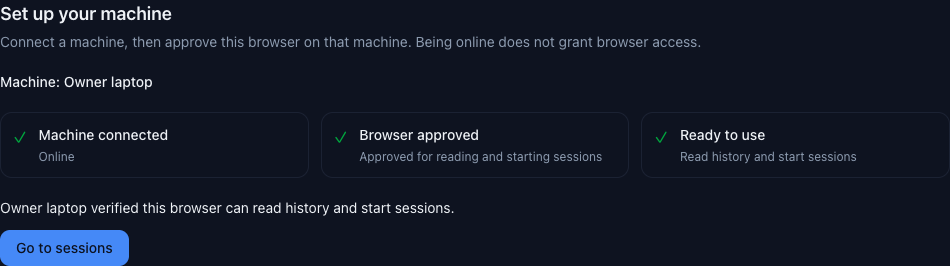

*9. Ready: the host verified this browser can read history and start
sessions.*

Choose **Go to sessions**. You can now start and follow sessions on that
machine from the hosted app.

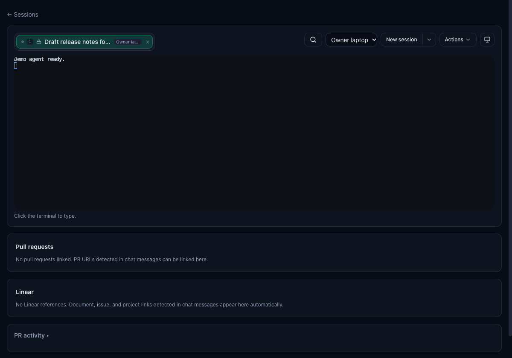

*10. A private session started from the hosted app and running on the host.*

## Part 2: someone else's browser

The other person needs their own account and their own browser profile. You
need the local host page on your machine.

### Signing in alone grants nothing

Until the other person publishes a key, **Add person** finds nothing for them,
even though their account exists.

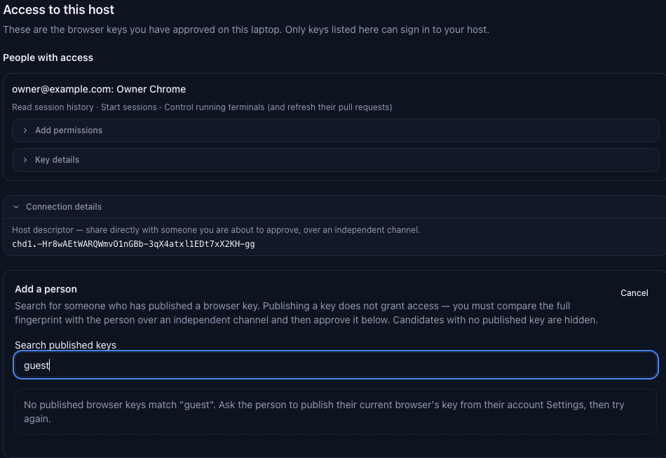

*11. An account without a published browser key cannot be found.*

When they sign in, their **Private** page says **No host is paired**. Their
account has no access to your host.

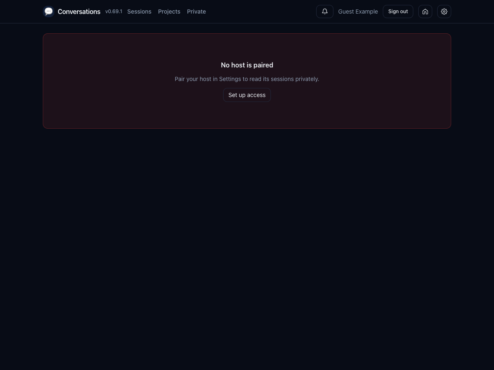

*12. The other person is signed in but has no host.*

### They connect to your host and publish their key

1. Send them your host descriptor (Connection details, image 3) directly.
   - The descriptor is public, but sending it to them yourself means they
     connect to the right machine.
   - Never send cookies, `open` links or passwords.
2. They open **Settings** → **Host access** in the hosted app.
3. They paste the descriptor, name the machine and their browser, then choose
   **Connect machine**.

They see the machine *Online* and their browser *Not approved*.

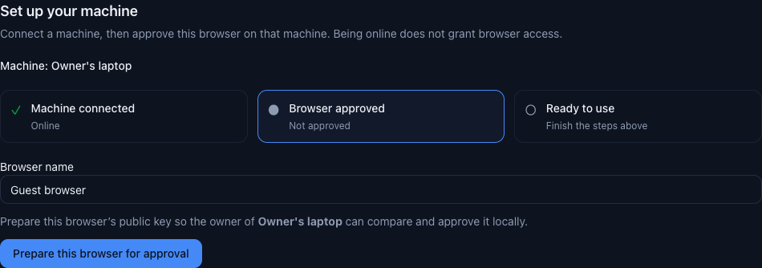

*13. The other person is connected to your machine, but not approved.*

They choose **Prepare this browser for approval**, which publishes their key
and shows their full fingerprint. They keep the page open.

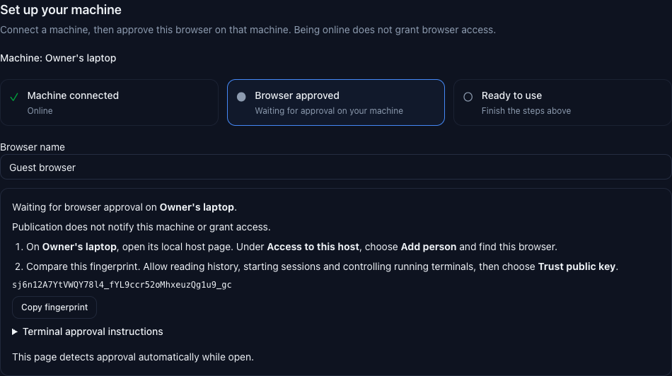

*14. The other person's fingerprint, waiting for your approval.*

### You compare the fingerprint and trust the key

1. In the local host page, choose **Add person** and search for their name or
   email.
   - The directory name is not proof of identity, as the page notes.
2. Select their browser.
3. Compare the full fingerprint with what they read out to you, over a call or
   another channel that you know reaches them.
   - Don't compare against a value that came through the server.
4. Pick only the permissions they need.
   - **Read session history** lets them read every session on this host.
   - **Start sessions** and **Control running terminals** let them run things
     on your machine.
5. Tick the comparison box, then choose **Trust public key**.

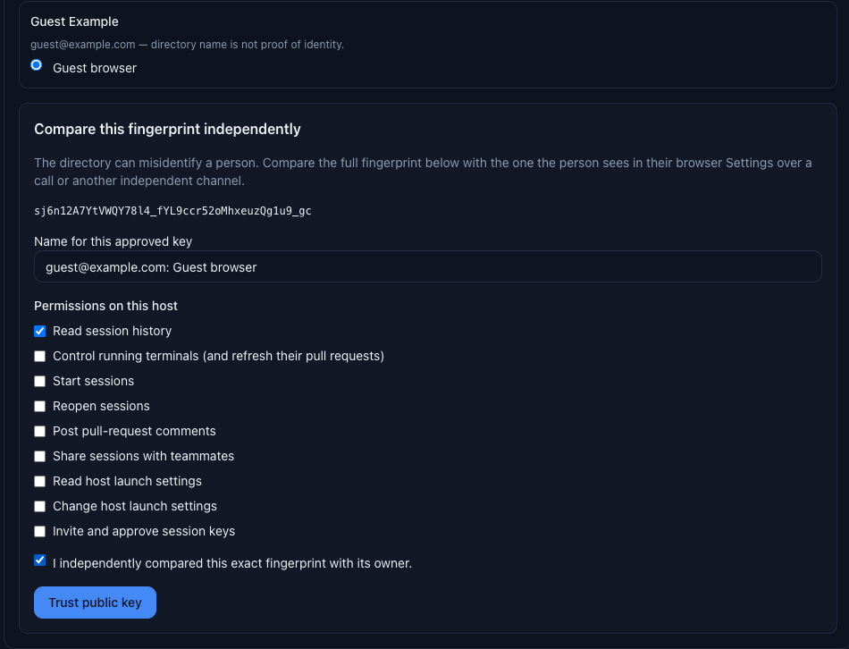

*15. Trusting the other person's key with read-only access.*

They now appear under **People with access**. **Key details** shows the full
fingerprint you approved.

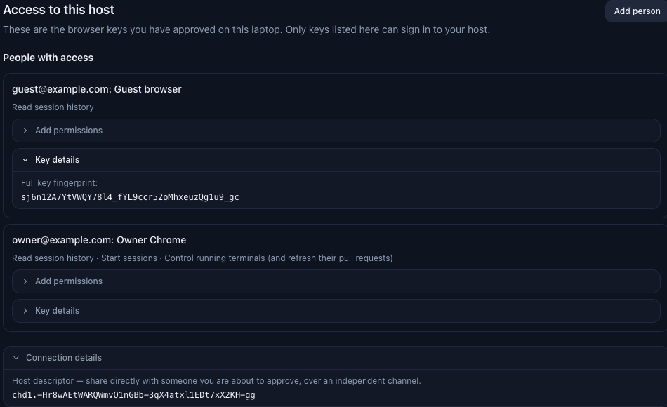

*16. Both browsers approved; the other person's fingerprint is under Key
details.*

### Approve a browser from the hosted app

To enable hosted approval, open **Settings → Host access** on the machine that
will grant access. Use **Add a device** to enroll an owner passkey if you need
one. Under **Add permissions**, enable **Approve browser keys
remotely with a passkey** on the owner passkey you will use to verify approvals.
Use an owner passkey with **Invite and approve session keys** if you unlock
the hosted app with that passkey. If you just added that permission, unlock
the hosted app again. If you connect using a directly approved
browser key, enable both permissions on that browser key as well. The
approving passkey and browser must each hold the access you want to give.

In the hosted app, select that machine in **Settings → Host access** and
choose **Add person**. Find the recipient's published key by name or email,
compare the full fingerprint with them, and choose the permissions. Select
**Trust public key** and complete the passkey prompt. The host checks the
permission again before it saves the key. The prompt expires after two
minutes. Administrative permissions still require local approval.

### What they can now do

Their setup page re-checks the approval on its own.

- **Full access.** With read, start and control permissions, it reaches
  *Ready*, as in image 9.
- **Read-only access.** With only **Read session history**, the setup check
  stops at *Needs review*. The host refuses the session-start part of the check
  ("capability outside credential ceiling"). This is expected for a read-only
  grant and does not block reading.

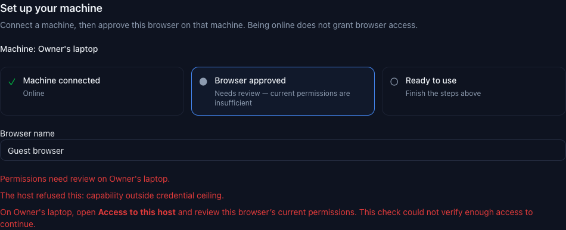

*17. A read-only browser shows Needs review in setup.*

Their **Private** page now lists your host's sessions.


*18. The other person sees your host's sessions.*

They can open a session and read the full conversation. With read-only access,
sending a reply is refused with the same "capability outside credential
ceiling" message.

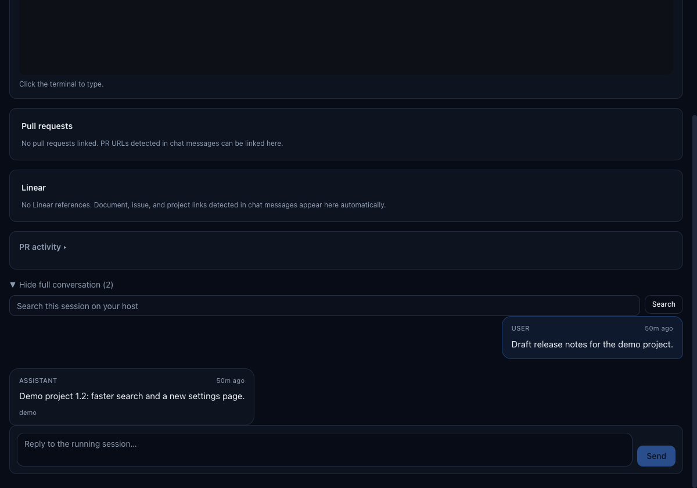

*19. Read access: the conversation is visible through your host.*

### Let someone type with you

To let another person type into your running sessions, trust their browser key
with **Read session history** and **Control running terminals**.

**Choose both permissions when you trust the key.** **Add person** ticks only
**Read session history** by default. **Add permissions** on a key you already
trusted cannot add terminal control later. So the read-only key above stays
read-only. Trust a new browser key for typing, for example from a separate
browser profile.

In this example a teammate (`teammate@example.com`) followed the same steps as
above: they connected to your machine and published their key, and you
compared the full fingerprint with what they read out.

1. In **Add person**, select their browser and compare the fingerprint.
2. Tick **Control running terminals** in addition to **Read session history**.
   Leave **Start sessions** unticked if they should only join sessions you
   start.
3. Tick the comparison box, then choose **Trust public key**.

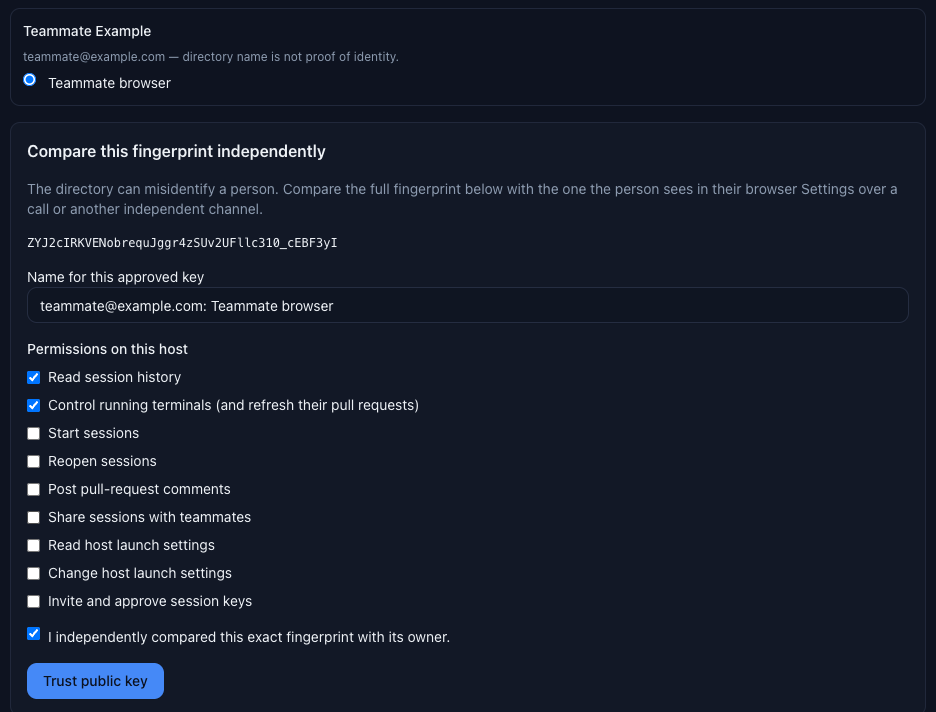

*20. Trusting the teammate's key with read and terminal control.*

Without **Start sessions**, their setup page shows *Needs review* with
"Session starts are not allowed". Reading and typing still work. This differs
from the read-only key in image 17, which has no terminal-control grant.

You start a session, and both of you open it from **Private**. It is the same
session on your machine, at the same address, in both browsers. To type, each
person clicks the terminal; the toolbar then shows **Keyboard captured**.
Clicking **Keyboard captured** releases the keyboard.

These steps also apply to Codex, Claude and OpenCode sessions: input reaches
the agent's existing terminal. The demo program below is only screenshot
content, not a replacement for the agent interface.

In this run, a harmless demo program echoed each line it received. The owner
typed `owner typed this line` in their browser. Then the teammate typed
`teammate typed this line` in theirs. Both lines reached the one program on
the owner's machine, and both browsers show both lines with the program's
`received:` replies.

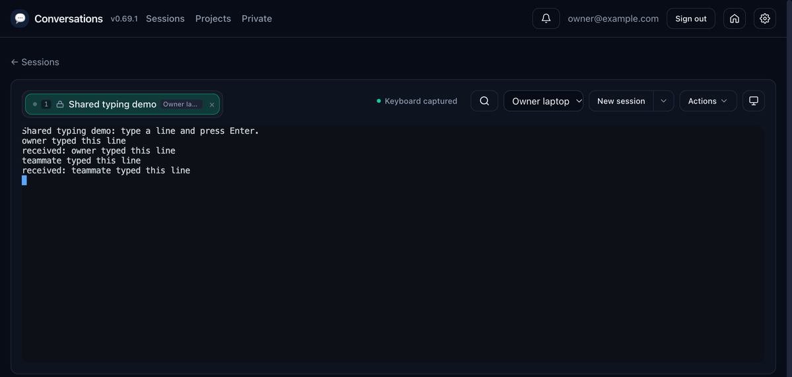

*21. The owner's browser (`owner@example.com`): the owner typed the first
line, the teammate the second.*

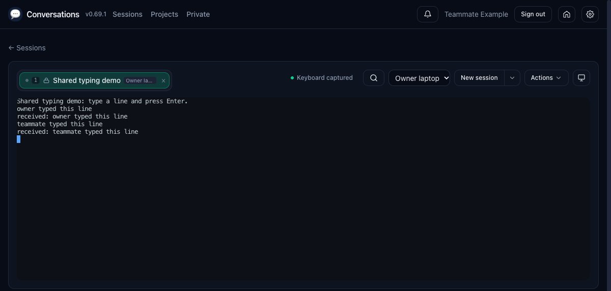

*22. The teammate's browser (Teammate Example): the same session and the same
two lines.*

How shared typing works:

- **Raw keyboard input.** Typing goes straight to the session's terminal, the
  same as typing on your machine. It is not the chat reply box.
- **No turn-taking.** Neither browser gets the keyboard exclusively. Your host
  passes each browser's keystrokes to the terminal in the order they arrive.
  If you both type at the same moment, your characters can mix, so agree who
  types.
- **Your machine checks every keystroke.** It accepts input only from keys
  trusted with **Control running terminals** and refuses it from every other
  key, including a read-only one.
- **Revocation stops it.** Revoking the key (see
  [Revoke access](#revoke-access)) stops their typing too.

### Host access versus session sharing

**Host access** (this guide) trusts a browser key on your machine. That browser
then acts on the host privately, within its permissions, for the host's
sessions.

**Session sharing** is per session, through a session's **Share session**
dialog:
- A **read-only copy** is published to the server for chosen people. They read
  it with their login, even while your host is offline, and they can never type
  into it.
- **Write access** to one session (**Allow typing**) is only for keys your
  host has already trusted. It can't give a key more than the permissions it
  was trusted with. A key trusted with **Control running terminals**, like the
  teammate's above, already types in every session and doesn't need it.

So sharing a session does not approve anyone's browser on your host, and host
access is not limited to one session.

To let someone else manage sharing, grant them **Share sessions with
teammates**.

## Revoke access

The local page has no revoke button. On the host machine, revoke the exact
fingerprint shown under **Key details**:

```sh
conversations credential revoke <full-fingerprint>
```

Revocation is permanent. As soon as the command records it:
- the key loses its grants;
- any browser delegations it parents stop;
- its undelivered agent messages and any work already queued are refused.

If the host is running, the command also asks it to interrupt the current
interaction of each affected session. Interrupting is a request, not a
guarantee, so read the command's output:
- **Per session.** It prints one line per session: for example *interrupt
  requested*, *idle, nothing to interrupt*, *interrupt unsupported for this
  agent*, *not confirmed interrupted*, or *restart it to upgrade*.
- **Host not running.** It reports that an interaction already running was
  not interrupted.

Interrupting never ends a session. Stop any interaction that was not
interrupted yourself.

The local page marks the key **Revoked**, with *No active permissions*.

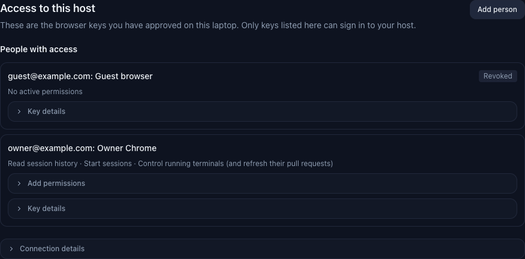

*23. The revoked key on the host.*

A revoked key cannot be trusted again: the host refuses it as revoked. To
restore access, the person creates a new browser key, for example in a new
browser profile, and you approve that key.

On their side, the setup goes back to waiting for approval, and the
**Private** page reports that the host refused access.


*24. After revocation, the other person's browser is no longer approved.*


*25. The other person's Private page after revocation: nothing was read.*

## Troubleshooting

**The host isn't running.** The hosted setup shows **Machine connected** as
*Offline* and asks you to start `conversations host` on that machine.
The page keeps checking while it is open. On the machine itself, `open` and
`start-agent` fail with *no local host is answering in …; start it with
`conversations host`*.

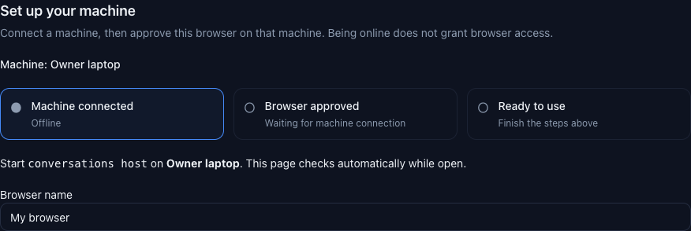

*26. The machine is offline.*

**An old host is still running after an upgrade.** `start-agent` fails with
*the local host in … is too old for `start-agent`; restart it with the current
`conversations host`*. Stop the old host and start it again.

**No published key, or an unknown key.**
- If **Add person** finds no one, ask the person to choose **Prepare this
  browser for approval** in that same browser, then search again (image 11).
- If their fingerprint doesn't match what you see, stop. Don't trust the key.
  Ask them to check that they're in the right browser profile.
- If the host refuses a browser as *unknown, revoked or expired credential*,
  that exact browser key isn't approved on this host.

**The wrong machine is selected.** When a browser is connected to more than one
machine, the hosted setup shows a **Machine** selector. Choose the machine
whose host approved this browser. Approval on one host grants nothing on
another.

**Permissions need review.** *Needs review — current permissions are
insufficient* means the key is approved, but not for reading history and
starting sessions. If that is intended, as for a read-only key (image 17),
nothing is wrong. Otherwise, approve a new browser key with the permissions
it needs: you can't widen the core permissions of a trusted key.

**Passkey unlock (optional).** Under **Advanced**, a browser can also be
unlocked with a passkey. When that delegation expires, setup shows *Locked —
unlock with your passkey*: unlock it again from the same browser. The
browser-key flow in this guide doesn't need a passkey.
